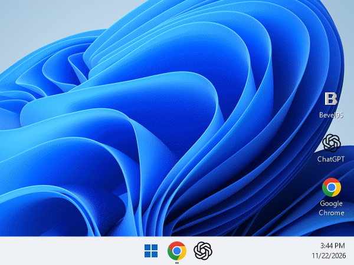

# Bevel95

Bevel95 is a Windows 95, 98 and 2000 style taskbar and Start menu for Windows 11, written from
scratch in Rust. It is a separate program that draws every pixel of the old look itself, sharp at
any screen scale, while today's Windows keeps running underneath. It also brings a classic
desktop, classic folder windows, and its own Minesweeper, Solitaire and Calculator, each in the
look you choose.

<picture>
  <source media="(min-resolution: 1.9dppx)" srcset="docs/img/bevel95-2x.gif" width="600">
  <source media="(min-resolution: 1.4dppx)" srcset="docs/img/bevel95-2x.gif" width="800">
  <source media="(min-resolution: 1.2dppx)" srcset="docs/img/bevel95.gif" width="480">
  
</picture>

Website: https://madkmedia.github.io/Bevel95/

## What it does

- **The taskbar**: a button for each window (grouped by program, or one per window, as you
  like), the Start button, the notification area with your programs' icons, the clock, the
  volume control, the network and battery icons.
- **Quick Launch** (on in the 98 and 2000 looks): one-click icons for your browser, your mail
  program, Show Desktop and Windows Explorer, then the shortcuts in Windows' own Quick Launch folder.
  A built-in icon you delete from the band comes back when you switch Quick Launch off and on again.
  Drag the grip after the icons to make the band wider or narrower: icons that do not fit are reached
  by small arrows (98 look) or by the "»" button's list (2000 look), as those Windows did.
- **The Start menu**: your programs, Documents, Settings, Find, Help, Run and Shut Down, as each
  of the three Windows showed them.
- **Three looks**: Windows 95, Windows 98 and Windows 2000, each with its own pictures, fonts and
  behaviour, never mixed. Each can also be shown as on a 16-color screen.
- **Sizes**: drawn at the original size and enlarged by a whole number (2x on a 150% screen),
  every pixel a square, never blurred. Sizes between whole numbers can be chosen too, in quarter
  steps (1.25x, 1.5x, 1.75x, ...); such a size is not pixel-exact, and Bevel95 Settings lets you
  choose how it is drawn: even pixels with mixed edges (the default), the same mixed by light,
  sharp but uneven pixels, or smooth.
- **A classic desktop** with its icons (it can be switched off), **folder windows** and **Windows
  Explorer** with the tree of folders, in each look. A file of a kind that Windows knew (.txt,
  .ini, .bat, .dll, .exe, .hlp, .bmp, ...) shows that Windows' own icon and type name; other
  files keep today's icons. Hidden files and folders show, faded, when
  Windows is set to show hidden items (File Explorer > View > Show > Hidden items); protected
  system files only when Windows does not hide them. Right-click the desktop and choose
  **Properties** for **Display Properties**: each look's own wallpapers and patterns (tiled,
  centered or, in 98 and 2000, stretched), drawn as that Windows drew them, Windows 2000's
  JPEG pictures too. **Browse...** takes a picture of your own in every look (BMP, DIB, JPEG,
  PNG or GIF, at most 16,384 pixels a side and 50 million pixels), drawn in the look's big
  pixels like everything else; Bevel95 remembers where the file is and does not copy it.
- **Minesweeper, Solitaire and the Calculator**, each in the look you use, with their Help.
- **Quick Search**: press the Windows key, type a few letters of a program's name, press Enter.
- **Bevel95 Settings** (right-click the taskbar, then **Bevel95**) for everything that is
  Bevel95's own.

What it deliberately does **not** do:

- It does not inject anything into other programs, does not patch or replace Explorer, does not
  change Windows' system colors and is not a theme. It is an ordinary program with its own
  windows.
- It does not remove Windows' taskbar. It hides it while Bevel95 runs and **always gives it
  back**: when you exit, when Bevel95 crashes, even when it is ended from Task Manager (a small
  watchdog process takes care of that).
- It writes to the registry only for "Start Bevel95 when Windows starts" (if you tick it) and for
  its line in Windows' list of installed apps (if you install it).
- It does not connect to the internet.

## What you need

- **Windows 11**, 64-bit (x64). That is where it is made and tried.
- Windows 10: one user reports that it works. It has not been tried here.

## Download and install

Bevel95 is **one file**, `Bevel95-<version>.exe` (about 15 MB), on the project's Releases page.
It holds all six programs. The SHA-256 fingerprint of each file is published beside it; to check
it, run `Get-FileHash Bevel95-<version>.exe` in PowerShell.

**Windows warns first**, because the file is not signed and few people have run it yet. Your
browser may say the file "isn't commonly downloaded": choose **Keep**. When you start it, a blue
box **Windows protected your PC** ("Unknown publisher") may appear: click **More info**, then
**Run anyway**. On a PC with **Smart App Control** switched on, Windows blocks unsigned programs
outright; Bevel95 cannot run there unless Smart App Control is off.

Double-click the file. **Bevel95 Setup** asks how you want to use it:

- **Install it on this computer**: Setup then asks for the look, whether to show the classic
  desktop, what the Windows key opens and whether Bevel95 starts with Windows. It copies the
  programs to `%LOCALAPPDATA%\Bevel95`, puts two shortcuts on your desktop (**Bevel95** and
  **Restore Windows taskbar**) and adds Bevel95 to Windows' list of installed apps.
- **Keep it portable**: it unpacks `bevel95.exe`, a `programs` folder and `settings.txt` next to
  the file and runs from there (a USB stick, a folder of your own). Nothing goes elsewhere.
  Put the file into a folder of its own: a folder that already holds another program's
  `settings.txt` cannot hold a portable copy (Setup says so and changes nothing). The first
  line of a portable copy's `settings.txt`, `# Bevel95 settings...`, marks it as Bevel95's: keep it
  (without it, Bevel95 says once that it cannot save its settings). If another program has that
  `settings.txt` open as you start the copy, Bevel95 says so and does nothing until it is closed.

To update later, run a newer file: Setup offers to update the installed copy and keeps your
settings.

**Without Setup**: each release also has `Bevel95-<version>-portable.zip`, the same portable copy
already unpacked. Unzip it into a folder of its own and start `bevel95.exe`; keep its
`settings.txt` beside it (without it, Bevel95 asks as Setup does). Such a copy has no desktop
shortcuts: Ctrl+Win+T, the bar's **Bevel95**, **Exit**, or `bevel95.exe --restore` in its folder
bring Windows' taskbar back.

## Switching back to Windows' taskbar, and removing Bevel95

- **Ctrl+Win+T** switches between Bevel95 and Windows' own taskbar at any time. While Windows'
  taskbar shows, a small silver B in its notification area (perhaps behind the little arrow)
  says Bevel95 still runs; click it to switch back.
- The **Restore Windows taskbar** shortcut on your desktop closes Bevel95 and brings Windows'
  taskbar back. If the classic desktop covers your shortcuts, press **Win+R** and run
  `%LOCALAPPDATA%\Bevel95\bevel95.exe --restore`: it does the same.
- To stop Bevel95: right-click the taskbar, **Bevel95**, **Exit**.
- If Windows' taskbar is ever missing: open Task Manager (**Ctrl+Shift+Esc**), right-click
  **Windows Explorer**, **Restart**. If the taskbar then hides until you move the mouse down,
  switch off Settings > Personalization > Taskbar > Taskbar behaviors > "Automatically hide the
  taskbar" (Bevel95 turns it on while it runs and back off after).

**Removing it**: Settings > Apps > Installed apps > **Bevel95** > **Uninstall** (or run the
downloaded file and choose **Remove**). It removes the programs, the shortcuts, its settings,
scores and logs, "Start with Windows" and its line in the list. A portable copy is removed by
exiting it and deleting its folder.

## What is not built yet

Bevel95 is young and incomplete. Among what is missing: a taskbar on every screen,
the taskbar on other edges of the screen, the classic balloon messages, Windows 98 Second
Edition, more classic programs (Notepad, Paint), other languages than English. See
[docs/roadmap.md](docs/roadmap.md).

## Files it uses

All in `%LOCALAPPDATA%\Bevel95` (a portable copy keeps them next to its `bevel95.exe`):

- `bevel95.exe` and the `programs` folder: the programs.
- `settings.txt`: the look, the size and every other setting (Bevel95 Settings and Taskbar
  Properties change it; it explains each line). Edit it in Notepad if you like and save it as UTF-8. A
  file Bevel95 cannot read (UTF-16, say) is left exactly as it is: Bevel95 runs on its defaults
  until it can read it again, and saves no setting into it.
- `programs.txt` and `programs.old.txt`: the programs you ticked for the Start menu, and a
  safety copy of that list.
- `desktop.txt` and `folders.txt`: where the classic desktop's icons lie, and each folder
  window's place, size and view.
- `background.txt`: the wallpaper and pattern chosen for each look in Display Properties.
- `undo.txt`, `task-order.txt`, `run-history.txt`, `quick-search.txt`: the folder windows' list
  of recent file operations, the order of the task buttons, the commands typed into Run, the
  width of Quick Search's Name column.
- `quick-launch.txt`: the built-in Quick Launch icons you took off the band (your own shortcuts
  stay in Windows' own Quick Launch folder), and the band's width once you have dragged it.
- `minefield.txt`, `solitaire.txt`, `calculator.txt`: the games' and the Calculator's options
  and scores.
- `bevel95.log` and `bevel95.old.log`: the log (see below).
- `windows-taskbar-state.txt`: exists only while Bevel95 runs; it remembers how Windows' taskbar
  was, so it can always be put back.
- `windows-taskbar-used.txt`: only in a portable copy's folder; it notes that the copy has put
  Windows' taskbar back from the installed copy's record once, so that old record is not used again.

## The log, and reporting a problem

Bevel95 writes what it did, and anything Windows refused to do, to
`%LOCALAPPDATA%\Bevel95\bevel95.log`. The log holds **no window titles, no file names, no text
you typed**: only Bevel95's own messages, Windows' class and program file names and error codes.

To report a problem, open an issue with the **Bug report** form. It asks for your Windows
version, the look and size you use, what you did, what you expected, what you saw, and the last
lines of the log. Read them before you paste them.

## Building from source

You need Windows, [Rust](https://www.rust-lang.org/tools/install) (stable, with the MSVC
toolchain) and Git.

```
cargo test --workspace
cargo build --workspace --release
```

The programs are in the build folder's `release` folder: `bevel95.exe` and the five other
programs (`bevel-help.exe`, `folders.exe`, `minefield.exe`, `solitaire.exe`, `calculator.exe`).
For everyday use, `tools\install.ps1` builds and installs them into `%LOCALAPPDATA%\Bevel95` with
the two desktop shortcuts; `tools\release.ps1` makes the one file. The decisions behind every
part are in [docs/decisions.md](docs/decisions.md), every measured color and size in
[docs/theme-spec.md](docs/theme-spec.md).

## Contributing

Contributions are welcome. Please read [CONTRIBUTING.md](CONTRIBUTING.md) first: it explains the
layers, what pixel-exact means here and how it is checked.

## Supporting Bevel95

Bevel95 is free and stays free. If you have enjoyed it and would like to support its development, there is a [Patreon page](https://patreon.com/madkmedia). Nothing is held back for supporters.

## License

GPL-3.0-or-later for Bevel95's own code ([LICENSE](LICENSE)). The Windows artwork (its pictures, sounds and the letters of its screen fonts) belongs to Microsoft and is not covered by it. Bevel95 is a hobby project for nostalgia and study; it is not affiliated with or endorsed by Microsoft.

## See also

Other projects that keep the classic Windows look alive:

- [RetroBar](https://github.com/dremin/RetroBar): a classic taskbar in the Windows 95 to Vista styles
- [Open-Shell](https://github.com/Open-Shell/Open-Shell-Menu): the classic Start menu
- [ExplorerPatcher](https://github.com/valinet/ExplorerPatcher): the Windows 10 taskbar and more on Windows 11
- [Cairo Desktop](https://github.com/cairoshell/cairoshell): a desktop environment for Windows
- [windows95](https://github.com/felixrieseberg/windows95): Windows 95 itself, running in an app
- [98.css](https://github.com/jdan/98.css): the Windows 98 look for web pages
- [ReactOS](https://github.com/reactos/reactos): a free Windows-compatible operating system
